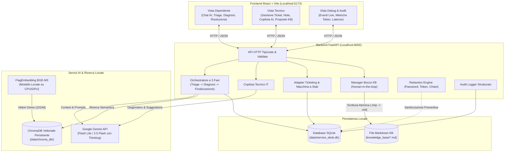

# Service Desk AI Assistant — Prototipo Locale

Assistente IT interno e copilota per il supporto, la diagnosi guidata e la risoluzione delle problematiche aziendali ricorrenti per una realtà di circa 500 dipendenti.  
Progettato secondo le specifiche di [`docs/task.md`](docs/task.md) e sviluppato progressivamente attraverso tutti i requisiti di affidabilità, sicurezza e tracciabilità stabiliti in [`AGENTS.md`](AGENTS.md).

---

## 1. Caratteristiche Principali del Progetto

- **Interfaccia Web a Tre Viste (`React + Vite + Tailwind CSS + Lucide React + Motion`)**:
  - **Vista Dipendente**: Chat interattiva con l'assistente, diagnosi guidata a 3 fasi (*triage*, *diagnosi*, *finalizzazione*), consultazione trasparente delle fonti Knowledge Base, widget interattivo di conferma risoluzione con barra timer progressiva integrata nel pulsante, blocco invio messaggi a problematica chiusa, e cronologia sessioni con categorie canoniche.
  - **Vista Tecnico**: Console operativa per gli specialisti IT con master-detail dei ticket, filtri incrociati per stato (`open`, `in_progress`, `resolved`, `closed` evidenziato in rosso brillante) e per categoria, correlazione manuale con incidenti noti, inserimento note tecniche e **Chat Copilota AI Dedicata** per suggerimenti operativi e sintesi diagnostiche.
  - **Vista Debug & Audit Log**: Dashboard unificata in tempo reale (auto-refresh a 3s) con feed eventi strutturati divisi per ruolo (*Dipendente*, *Tecnico*, *Sistema & RAG*), card collassabili, ripartizione token LLM (prompt, reasoning/thinking, completion, totale), latenza effettiva in millisecondi e anteprima dei messaggi sanitizzati.
- **Backend Robusto e Tipizzato (`Python 3.12 + FastAPI + SQLAlchemy + Pydantic v2`)**:
  - Unico punto di contatto per le chiamate LLM; nessuna esposizione di credenziali al frontend.
  - SQLite persistente (`data/service_desk.db`) con foreign key enforced (`PRAGMA foreign_keys = ON`), schema versionato con Alembic e persistenza totale al riavvio.
  - Sanitizzazione e redazione automatica dei segreti (`redact_secrets`) per password, Bearer token e API key prima di qualsiasi scrittura su DB o audit log.
- **Motore RAG Locale Sovrano (`FlagEmbedding BGE-M3 + ChromaDB`)**:
  - Encoder denso multilingua BGE-M3 eseguito localmente (zero dipendenze da API esterne per gli embedding).
  - Indicizzazione e chunking semantico di documenti Markdown con front matter YAML (`knowledge_base/`).
  - Ricerca per similarità semantica con soglia di rilevanza minima (`RAG_MIN_RELEVANCE_SCORE = 0.48`), esclusione automatica di guide `draft` e `archived`, e supporto al fallback offline deterministico.
- **Workflow Human-in-the-Loop per il Miglioramento della KB**:
  - Risoluzioni confermate dai dipendenti e ticket risolti dai tecnici possono generare automaticamente bozze di articoli tecnici Markdown.
  - Workspace di revisione tecnico con rilevamento semantico di articoli duplicati/sovrapposti.
  - Pubblicazione atomica su disco (`.tmp` -> replace atomico + backup `.bak`) e re-indicizzazione istantanea solo previa esplicita approvazione umana.
- **Categorie Canoniche Allineate a `docs/task.md` & Titolazione Dinamica**:
  - Categorie supportate: `Reset Password`, `Problemi Email`, `Malfunzionamenti Software`, `Richiesta Generica`.
  - **Zero Extra Turns (`session_meta`)**: Gemini restituisce direttamente nella risposta di turno il titolo sintetico proposto, la categoria normalizzata e la decisione sulla fase (`triage` vs `diagnosis`).
  - L'orchestratore estrae i metadati, aggiorna il database relazionale e rimuove il blocco JSON dal messaggio visibile all'utente. Se il problema è chiaro fin dal primo turno, l'agente passa subito a `diagnosis`; altrimenti rimane in `triage` e formula domande mirate di chiarimento.

---

## 2. Architettura Concettuale e Distinzione delle Entità



### Entità Distinte del Modello Dati
1. **`Conversation`**: sessione di chat aperta con un dipendente, persistente e riapribile; non equivale a un ticket.
2. **`SupportRequest`**: problematica IT rilevata o registrata nel thread; traccia fase (`triage`, `diagnosis`, `finalization`) ed esito (`resolved_confirmed`, `resolved_unconfirmed`, `escalated`, `abandoned`).
3. **`Ticket`**: record operativo assegnato a un tecnico umano, generato **esclusivamente** a seguito di escalation formale (non per problemi risolti dal bot).
4. **`Incident`**: disservizio condiviso dell'infrastruttura aziendale (es. down server di posta o VPN) a cui possono essere correlati più ticket senza fonderli.

---

## 3. Prerequisiti

- **Sistema Operativo:** Linux (Ubuntu/Debian raccomandato), macOS o Windows WSL2
- **Python:** 3.11 o 3.12 (verificato su Python 3.12.3)
- **Node.js:** 18+ o 20+ (verificato su Node v20.20.2 e npm 10.8.2)
- **Dipendenze Esterne:** Nessun database server (MySQL/PostgreSQL) da installare; SQLite e ChromaDB risiedono localmente nella cartella `data/`.
- **Connessione Internet:** Richiesta solo per chiamare le API di Google Gemini (se configurata la chiave) o per il download iniziale delle dipendenze/modello BGE-M3. L'intero sistema funziona offline con stub/fake deterministici.

---

## 4. Installazione e Configurazione Rapida

### 4.1 Configurazione delle Variabili d'Ambiente
Clonare il repository e copiare il file template:
```bash
cp .env.example .env
```
Opzionale: per abilitare le risposte reali di Google Gemini, impostare la propria chiave all'interno del file `.env`:
```ini
GEMINI_API_KEY="la-tua-chiave-gemini"
```
*(Se la chiave non è impostata, il server si avvia regolarmente e la UI mostra un badge informativo non bloccante).*

### 4.2 Installazione Unificata
È sufficiente eseguire:
```bash
make install
```
Questo comando crea l'ambiente virtuale `.venv`, aggiorna `pip`, installa i requisiti Python (`requirements.txt` e `requirements-dev.txt`) ed esegue `npm install` nella directory `frontend/`.

---

## 5. Avvio dell'Applicazione in Locale

Avviare backend e frontend in due terminali separati:

### Terminale 1 — Backend FastAPI
```bash
make dev-backend
```
- Server attivo su: **`http://localhost:8000`**
- Documentazione interattiva OpenAPI (Swagger UI): **`http://localhost:8000/docs`**
- Controllo salute e connettività DB: **`http://localhost:8000/api/health`**

### Terminale 2 — Frontend React (Vite)
```bash
make dev-frontend
```
- Applicazione Web attiva su: **`http://localhost:5173`**
- Switch in alto a destra per alternare tra:
  1. `Dipendente`
  2. `Tecnico`
  3. `Debug & Audit`

---

## 6. Comandi Utili del Progetto (`Makefile`)

| Comando | Descrizione |
|---|---|
| `make check` | **Controllo di qualità totale**: esegue sequenzialmente tutti i test (backend e frontend), ruff, eslint, mypy, tsc e build di produzione. |
| `make test` | Esegue l'intera suite di test automatizzati (backend + frontend). |
| `make test-backend` | Esegue i test unitari e di integrazione backend con `pytest` (140 test). |
| `make test-frontend` | Esegue i test dei componenti frontend con `vitest` (25 test). |
| `make lint` | Esegue il linter Python (`ruff`) e il linter frontend (`eslint`). |
| `make type-check` | Esegue il type-checker statico `mypy` sul backend e `tsc --noEmit` sul frontend. |
| `make build` | Compila e ottimizza il bundle di produzione del frontend in `frontend/dist/`. |
| `make migrate` | Applica le migrazioni di schema del database tramite Alembic (`alembic upgrade head`). |
| `make reset-demo` | **Reset sicuro della demo**: cancella i dati di test, ripristina gli incidenti noti di seed e reindicizza la KB originale senza toccare il file `.env`. |
| `make rag-index` | Indicizza i documenti Markdown della KB su ChromaDB con il modello locale BGE-M3. |
| `make rag-index-fake` | Indicizzazione istantanea con encoder deterministico offline per test rapidi. |
| `make rag-eval` | Esegue il benchmark RAG quantitativo su dataset di query italiane calcolando Recall@5 e latenza. |
| `make rag-eval-offline` | Esegue il benchmark RAG offline deterministico in pochi secondi. |

---

## 7. Knowledge Base e Motore RAG (Risultati Benchmark)

La Knowledge Base risiede in `knowledge_base/` con guide operative approvate in formato Markdown e Front Matter YAML:
- `reset_password.md` (`KB-AUTH-001`): Procedura SSPR e policy account Active Directory.
- `email_outlook.md` (`KB-MAIL-001`): Configurazione Outlook desktop/webmail, quote e limiti allegati.
- `vpn_access.md` (`KB-NET-001`): Connessione SecureConnect VPN, certificati e split tunneling.
- `wifi_network.md` (`KB-NET-002`): Connessione Wi-Fi Corporate 802.1X e Guest portal.
- `mfa_setup.md` (`KB-AUTH-002`): Configurazione Microsoft Authenticator e backup codici.
- `file_share.md` (`KB-FILE-001`): Mapping cartelle di rete SMB H: (personale/dipartimento) e S: (scambio).
- `software_catalog.md` (`KB-APP-001`): Installazione Company Portal e licenze software aziendali.
- `incident_management.md` (`KB-OPS-001`): Status page disservizi, policy incidenti noti ed emergenze.

### Risultati del Benchmark su Query Reali in Italiano (`backend/scripts/eval_dataset.json`):
Valutazione condotta su 22 query realistiche formulate da utenti aziendali in lingua italiana:

| Metrica | BGE-M3 Locale (`BAAI/bge-m3`) | Fake Encoder Deterministico |
|---|---|---|
| **Recall@5** | **100.0%** (21/21 hit in-scope) | 38.1% (8/21 hit) |
| **MRR@5** | **1.0000** (tutti i documenti al 1° posto) | 0.1444 |
| **Latenza Mediana (P50)** | 346.33 ms | 5.06 ms |
| **Latenza Media** | 536.45 ms | 4.97 ms |
| **Dimensioni Vettore** | 1024 float32 | 1024 float32 |

---

## 8. Contratti API REST Principali

La documentazione interattiva completa e navigabile è accessibile via Swagger UI su `http://localhost:8000/docs`. Di seguito i principali endpoint:

| Metodo | Endpoint | Descrizione |
|---|---|---|
| `GET` | `/api/health` | Controllo disponibilità backend, versione e connettività SQLite |
| `GET` | `/api/conversations` | Lista paginata delle conversazioni con titolo, categoria ed esito |
| `POST` | `/api/conversations` | Creazione di una nuova conversazione (`title`, `user_id`) |
| `GET` | `/api/conversations/{id}` | Dettaglio conversazione con messaggi cronologici e richieste associate |
| `POST` | `/api/conversations/{id}/messages` | Invio messaggio con sanitizzazione preventiva dei segreti |
| `POST` | `/api/conversations/{id}/turn` | Esecuzione turno assistente con recupero RAG e transizione di fase |
| `POST` | `/api/conversations/{id}/requests` | Registrazione formale di una problematica IT (`SupportRequest`) |
| `POST` | `/api/requests/{id}/confirm-resolution` | Conferma risoluzione (da utente o auto-timer); blocca se esiste ticket aperto |
| `POST` | `/api/requests/{id}/reopen` | Riapertura richiesta e annullamento proposta di risoluzione |
| `GET` | `/api/tickets` | Elenco ticket tecnici con filtri per stato (`status`), categoria (`category`) e incidente |
| `GET` | `/api/tickets/{id}` | Dettaglio ticket completo con rilievi diagnostici, fonti KB e cronologia note |
| `POST` | `/api/tickets/{id}/status` | Avanzamento stato ticket validato server-side (HTTP 409 su transizione illegale) |
| `POST` | `/api/tickets/{id}/notes` | Aggiunta nota tecnica con redazione automatica segreti |
| `POST` | `/api/tickets/{id}/incident` | Correlazione o dissociazione ticket con incidente noto |
| `GET` | `/api/tickets/{id}/chat` | Cronologia messaggi del copilota tecnico per il ticket selezionato |
| `POST` | `/api/tickets/{id}/chat` | Turno interattivo con il copilota tecnico AI con proposte operative |
| `GET` | `/api/kb-proposals` | Lista proposte KB con filtro per stato (`draft`, `approved`, `rejected`) |
| `POST` | `/api/kb-proposals/generate` | Generazione automatica bozza KB da richiesta risolta o ticket chiuso |
| `POST` | `/api/kb-proposals/{id}/publish` | Approvazione, scrittura atomica su file `.md` e re-indicizzazione RAG |
| `GET` | `/api/audit/events` | Feed eventi di audit strutturati con filtro per ruolo (`employee`, `technician`, `system`) |
| `GET` | `/api/audit/conversations` | Lista thread per menu a tendina debug con conteggio eventi |

---

## 9. Misure di Sicurezza e Invarianti di Affidabilità

1. **Nessun Falso Positivo / Mai Fingere il Successo:** Se una chiamata Gemini o un'operazione database fallisce, il sistema non finge il completamento dell'azione ma produce un messaggio chiaro di errore e mantiene lo stato coerente.
2. **Sanitizzazione Preventiva dei Segreti:** Tramite `backend/app/core/redaction.py`, qualsiasi password, bearer token o chiave API inserita per errore dall'utente o dal tecnico viene mascherata (`[REDACTED_PASSWORD]`, `[REDACTED_TOKEN]`, `[REDACTED_API_KEY]`) prima della persistenza su database o dell'emissione negli audit log.
3. **Contenuto RAG Non Attendibile:** I frammenti recuperati dalla Knowledge Base e i campi degli incidenti sono marcati esplicitamente nei prompt di sistema come dati documentali informativi e non come istruzioni di sistema eseguibili (prevenzione di attacchi di prompt injection indiretto).
4. **Idempotenza e Protezione dello Stato:** La creazione di ticket previene duplicati per richieste già aperte; le transizioni di stato dei ticket seguono una macchina a stati esplicita e validata; i ticket assegnati a tecnici umani non possono essere chiusi dal bot o dall'utente tramite self-service.
5. **Human-in-the-Loop per la KB:** Nessun articolo della Knowledge Base viene pubblicato o sovrascritto autonomamente dal modello AI: ogni bozza richiede la revisione, il controllo duplicati e l'esplicita approvazione del personale IT.

---

## 10. Documentazione Approfondita

Per un'analisi dettagliata di tutte le decisioni tecniche, le motivazioni architetturali ("perché"), i trade-off delle alternative scartate e le metriche di affidabilità, consultare il documento:  
👉 **[`docs/ARCHITETTURA_E_DECISIONI.md`](docs/ARCHITETTURA_E_DECISIONI.md)**
