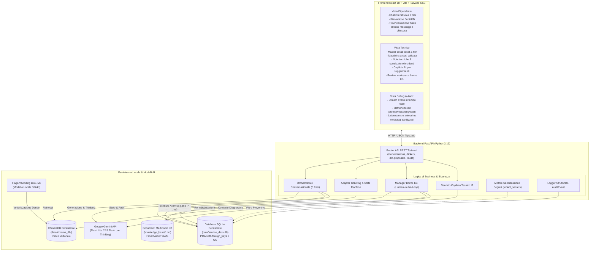

# Architettura di Sistema, Decisioni Tecniche e Misure di Affidabilità
## Service Desk AI Assistant — Prototipo Locale per 500 Dipendenti

**Autore:** Antigravity AI Pair Programmer & Team di Ingegneria  
**Data:** Novembre 2026  
**Riferimenti di Specifica:** [`docs/task.md`](task.md), [`AGENTS.md`](../AGENTS.md), [`README.md`](../README.md)  
**Stato Implementativo:** Completo, testato e validato (Milestone G01 – G07)

---

## 1. Contesto Aziendale, Missione e Requisiti di Business

Il progetto nasce per rispondere a un'esigenza operativa tipica di un'azienda di medie dimensioni (circa 500 dipendenti): la saturazione del Service Desk IT causata da un elevato volume di richieste ripetitive e ad alto assorbimento di tempo.

Dall'analisi dei requisiti presentata in `docs/task.md`, oltre il 60-70% dei ticket aperti quotidianamente riguarda problematiche ricorrenti e a bassa complessità:
- **Reset password e sblocco account** (credenziali scadute, policy Active Directory, configurazione MFA);
- **Problemi di accesso alla posta elettronica** (quota Outlook superata, configurazione client, mancato recapito);
- **Malfunzionamenti software comuni** (crash di Microsoft Teams, anomalie di Excel/Office, Company Portal);
- **Richieste generiche di supporto e policy IT** (connessione Wi-Fi aziendale, split tunneling VPN, mapping cartelle SMB).

### Vincoli Fondamentali e Obiettivi di Progetto
1. **Local-First per Sovranità e Privacy:** Il prototipo deve essere interamente installabile ed eseguibile su una workstation aziendale standard. L'indice vettoriale, il database applicativo, la base di conoscenza e i log risiedono su disco locale. Nessun database server (MySQL/PostgreSQL) né infrastruttura cloud è richiesta per l'operatività di base, preservando la totale riservatezza delle comunicazioni interne.
2. **Robustezza dei Flussi e Correttezza Operativa:** La qualità del sistema non è valutata dal numero di librerie o dall'effetto "magico" dell'AI, ma dall'integrità dei dati, dalla tracciabilità delle azioni e dalla gestione deterministica dei casi limite (errori API, timeout, tentativi di escalation multipli).
3. **Interfaccia a Ruolo Multiplo senza Barriere:** Una shell web moderna con switch immediato tra **Dipendente** (self-service), **Tecnico** (console operativa) e **Debug & Audit** (trasparenza architetturale), senza sovrastrutture IAM o login bloccanti nel prototipo locale.

---

## 2. Architettura Logica Complessiva

Il sistema adotta un'architettura modulare a responsabilità separate:



---

## 3. Decisioni Tecniche Fondamentali e "Perché"

### A. Perché un Singolo Agente Logico a Tre Fasi invece di un Sistema Multi-Agent?

Una delle tendenze emergenti nello sviluppo LLM è l'impiego di framework multi-agent complessi (es. LangGraph, CrewAI, AutoGen), in cui entità distinte ("Agente Triage", "Agente Diagnosi", "Agente Escalation") comunicano tra loro scambiandosi messaggi in linguaggio naturale.

Per questo progetto, **tale approccio è stato esplicitamente scartato** a favore di un **singolo agente logico controllato da una macchina a stati finita lato backend**.

#### Motivazioni del Trade-Off:
1. **Latenza e Consumo Token Ridotti:** Un sistema multi-agente richiede turni di meta-conversazione e parsing a cascata, moltiplicando le chiamate LLM (3–5 chiamate per singolo messaggio utente). Nel nostro approccio, ogni interazione utente genera esattamente **una sola chiamata LLM principale** contestualizzata.
2. **Determinismo delle Fasi di Supporto:** La transizione tra le fasi (`triage` → `diagnosis` → `finalization`) è regolata da logica applicativa trasparente basata sullo stato della `SupportRequest`, non da negoziazioni opache tra modelli. Il backend decide quale prompt di sistema, quali tool e quale livello di ragionamento attivare.
3. **Eliminazione di Deadlock e Allucinazioni da Passaggio di Contesto:** Nei sistemi multi-agent, il passaggio di testimone comporta sintesi non deterministiche in cui dettagli tecnici cruciali (es. codici di errore o indirizzi IP) vengono frequentemente omessi o alterati. Il singolo agente logico legge sempre la sequenza originaria dei messaggi sanitizzati.
4. **Strategia "Thinking Level" per Fase:**
   - **Fase 1 (Triage):** `Gemini Flash Lite` con `thinking_level = "medium"` per classificare rapidamente l'intento e raccogliere dettagli mancanti.
   - **Fase 2 (Diagnosi/Risoluzione):** `Gemini 2.5 Flash` con `thinking_level = "high"` per analizzare a fondo i chunk della Knowledge Base, correlare incidenti attivi e formulare step operativi precisi.
   - **Fase 3 (Finalizzazione):** `Gemini Flash Lite` con `thinking_level = "medium"` per confermare l'esito della risoluzione con un riepilogo pulito.

---

### B. Perché BGE-M3 Locale invece di API di Embedding Esterne o Modelli Leggeri?

La ricerca semantica nella Knowledge Base richiede la trasformazione dei testi in vettori numerici densi. La scelta iniziale vincolante è stata `BAAI/bge-m3` eseguito localmente tramite la libreria `FlagEmbedding`.

#### Motivazioni del Trade-Off:
1. **Sovranità dei Dati e Indipendenza dalla Rete:** In un contesto aziendale, le guide IT interne possono contenere informazioni riservate su architetture, sottoreti e convenzioni di sistema. Utilizzare un modello locale garantisce che i documenti non escano mai dall'infrastruttura aziendale.
2. **Supporto Linguistico Superiore per l'Italiano Tecnico:** I modelli di embedding mono-lingua inglesi (come quelli standard di default) falliscono sistematicamente quando interrogati con frasi italiane contenenti acronimi o termini ibridi (es. *"non riesco ad autenticarmi con l'authenticator e la vpn si scollega"*). BGE-M3 è stato addestrato nativamente su oltre 100 lingue con architettura mista.
3. **Risultati Empirici del Benchmark (Recall@5 = 100%):**
   Nel benchmark quantitativo condotto su 22 query realistiche in italiano formulate da utenti aziendali (`backend/scripts/eval_dataset.json`), BGE-M3 ha conseguito:
   - **Recall@5:** **100.0%** (21/21 hit in-scope);
   - **MRR@5 (Mean Reciprocal Rank):** **1.0000** (il documento rilevante è risultato essere la prima scelta assoluta per ogni singola query);
   - **Latenza Mediana:** 346 ms su CPU standard, ampiamente sostenibile per un'interazione utente fluida.
4. **Resilienza con Fake Encoder per Test Offline:** Per consentire l'esecuzione istantanea della suite di test in ambienti CI/CD privi di GPU o connessione, è stato implementato un `DeterministicFakeEncoder` che simula la distribuzione dimensionale a 1024 float32 garantendo test deterministici a costo computazionale nullo.

---

### C. Perché Separare Rigorosamente `Conversation`, `SupportRequest`, `Ticket` e `Incident`?

Uno degli errori più diffusi nella progettazione di bot per il Service Desk è l'equivalenza implicita *1 Chat = 1 Ticket*. Questa confusione strutturale degrada le metriche aziendali e complica i flussi operativi.

| Entità | Scopo Architetturale | Ciclo di Vita | Relazione |
|---|---|---|---|
| **`Conversation`** | Canale di comunicazione persistente tra un dipendente e l'assistente IT. | Può restare aperto indefinitamente e accogliere più problematiche nel tempo. | 1 Conversation : N SupportRequest |
| **`SupportRequest`** | Problematica o bisogno specifico espresso dal dipendente (es. *"Non ricordo la password"*). | Nasce nel triage, attraversa la diagnosi e raggiunge un esito (`resolved_confirmed`, `escalated`, ecc.). | 1 SupportRequest : 0..1 Ticket |
| **`Ticket`** | Record operativo per tecnici umani nel sistema di Service Desk mock. | **Viene creato esclusivamente su escalation formale.** Non esiste per richieste risolte dal bot. | N Ticket : 0..1 Incident |
| **`Incident`** | Disservizio infrastrutturale condiviso (es. malfunzionamento del cluster Exchange). | Gestito centralmente dall'IT Operations. Segnala lo stato (`investigating`, `identified`, `monitoring`, `resolved`). | 1 Incident : N Ticket |

#### Vantaggi Operativi della Separazione:
1. **Nessun "Ticket Zombie":** Se il bot risolve autonomamente un reset password in 45 secondi, l'evento viene registrato come `SupportRequest` con esito `resolved_confirmed`. **Nessun ticket viene inserito nella coda dei tecnici**, abbattendo drasticamente il rumore operativo.
2. **Continuità Post-Escalation:** Quando una richiesta viene scalata e genera un ticket (es. `TICK-A1B2C3D4`), la chat del dipendente non viene chiusa o congelata. L'utente può continuare a scrivere fornendo ulteriori dettagli (es. codici di errore o screenshot), che confluiscono nella cronologia del ticket visibile al tecnico.
3. **Correlazione di Massa senza Duplicazioni:** Se un guasto alla VPN produce 40 richieste da dipendenti diversi, i tecnici possono collegare ciascun ticket all'incidente noto `INC-2026-002`. I ticket rimangono distinti per tracciare i singoli utenti, ma la causa radice e le comunicazioni vengono governate in modo centralizzato.

---

### D. Perché la Pubblicazione della Knowledge Base Richiede Approvazione Umana (Human-in-the-Loop)?

Il sistema include un meccanismo di auto-miglioramento: quando una problematica viene risolta con successo (dal bot o dal tecnico), è possibile generare una bozza di articolo per la Knowledge Base aziendale.

Tuttavia, **il sistema vieta categoricamente la pubblicazione o l'indicizzazione autonoma di articoli generati dall'LLM senza intervento umano.**

#### Giustificazione della Scelta:
1. **Prevenzione del "Model Collapse" e delle Allucinazioni Cicliche:** Se un modello AI potesse scrivere e indicizzare direttamente nuove guide, un'eventuale imprecisione o procedura non conforme generata in una sessione verrebbe salvata su file Markdown, vettorizzata in ChromaDB e successivamente recuperata come "fonte autorevole" per gli utenti successivi. Questo creerebbe un circolo vizioso di allucinazioni auto-alimentate.
2. **Responsabilità e Compliance di Sicurezza:** Una procedura di configurazione di rete o di gestione credenziali può introdurre vulnerabilità o violare policy di sicurezza aziendali. Solo un operatore umano qualificato può validare che la guida rispetti gli standard della compagnia.
3. **Controllo Duplicati e Sovrapposizioni Semantiche:** Nel workspace di revisione (`TechnicianView`), prima di approvare una bozza, il sistema interroga ChromaDB per individuare guide preesistenti semanticamente affini. Il tecnico può quindi scegliere consapevolmente se:
   - Creare un nuovo documento (`new_document`);
   - Aggiornare ed espandere un documento esistente (`update_existing`);
   - Rifiutare esplicitamente la proposta indicandone la motivazione (`reject`).

---

### E. Perché un Workflow di Conferma Risoluzione con Timer Fluido e Blocco Chat?

Un principio cardine di `AGENTS.md` stabilisce che **l'inattività dell'utente non equivale a una risoluzione confermata**. Se un dipendente smette di rispondere a un bot, potrebbe essere soddisfatto, ma potrebbe altrettanto verosimilmente essere bloccato, frustrato o aver abbandonato la postazione.

#### Meccanismo Implementato:
1. **Riconoscimento Intent e Proposta Risoluzione:** Quando l'assistente verifica il completamento della procedura di supporto o l'utente scrive frasi di successo (*"grazie sono riuscito ad entrare"*, *"password ripristinata"*), la richiesta entra in `finalization` e l'assistente chiede conferma esplicita della risoluzione.
2. **Barra Timer Progressiva Integrata nel Pulsante:** Nell'interfaccia utente compare un widget compatto sopra l'input chat. Il pulsante principale *"Il problema è risolto"* incorpora una barra fluida che scorre da destra a sinistra nel corso di 2 minuti, passando visivamente da verde brillante a verde scuro.
   - Non sono presenti timer numerici burocratici o scritte allarmanti, preservando un'estetica calma ed elegante.
   - Se l'utente clicca il pulsante: la richiesta viene chiusa istantaneamente (`resolved_confirmed`) con evento di audit dedicato.
   - Se l'utente digita un nuovo messaggio o clicca *"Continua conversazione"*: il timer viene cancellato immediatamente e la richiesta rimane in diagnosi.
   - Se il timer scade (120 secondi): la richiesta viene chiusa automaticamente con tracciamento trasparente (`confirmed_by_user = false`), garantendo che le sessioni completate non restino pendenti all'infinito.
3. **Blocco Chat Post-Risoluzione:** A problematica chiusa, l'area di input viene disabilitata con messaggio esplicito. Questo impedisce di inviare messaggi spuri a contesti ormai finalizzati, invitando il dipendente ad aprire una nuova richiesta se si presenta un problema differente.
4. **Ticket Protection Guard:** Il sistema impedisce sia all'utente che al bot di auto-risolvere o chiudere richieste per le quali è già stato aperto un ticket di supporto tecnico. Una volta che un problema è in carico a un tecnico umano, solo il tecnico ha l'autorità di chiudere il ticket.

---

## 4. Alternative Architetturali Scartate

Durante la progettazione e l'evoluzione delle milestone, diverse alternative tecnologiche sono state valutate e consapevolmente respinte:

| Alternativa Scartata | Soluzione Adottata | Motivazione Tecnica del Rifiuto |
|---|---|---|
| **Multi-Agent Frameworks (LangGraph, CrewAI, AutoGen)** | Orchestratore a 3 Fasi controllato da Macchina a Stati | Eccessiva latenza (3-5x chiamate API per turno), rischio di deadlock comunicativo, costo in token sproporzionato, difficoltà di audit deterministico e perdita di controllo transazionale. |
| **Vector DB Cloud / Esterni (Pinecone, Qdrant cluster, Milvus)** | ChromaDB locale persistente su SQLite/DuckDB | Violazione del vincolo Local-First, costi di abbonamento ricorrenti, dipendenza dalla connettività internet per ogni ricerca interna e complessità infrastrutturale non necessaria per 500 dipendenti. |
| **Generazione e Pubblicazione KB Autonoma (Zero-Human-in-the-Loop)** | Workspace di proposta bozze con approvazione umana | Rischio di inquinamento della base di conoscenza con allucinazioni di secondo livello; impossibilità di verificare la conformità di sicurezza senza validazione tecnica. |
| **Chiusura Implicita per Timeout Chat (Stile Helpdesk Tradizionale)** | Conferma interattiva con barra timer fluida a 2 minuti | Considerare l'abbandono come risoluzione falsa le metriche aziendali e nasconde i problemi irrisolti; il timer fluido offre certezza senza ansia visiva. |
| **Autenticazione Utente Complessa (OAuth2 / Keycloak / SAML) nel Prototipo** | Switch di ruolo immediato (`Dipendente` / `Tecnico` / `Debug`) | Overhead di configurazione e dipendenze che avrebbero ostacolato la rapida dimostrabilità locale del prototipo. Le responsabilità di accesso sono confinate a livello di API server-side. |
| **Regex per la Decisione di Escalation Ticket** | Tool call esplicito controllato dall'LLM (`create_ticket`) | I pattern regex sono rigidi e incapaci di cogliere l'intento implicito di insuccesso diagnostico. L'LLM decide semanticamente quando invocare il tool di escalation formulando contestualmente il riepilogo diagnostico strutturato. |

---

## 5. Misure di Sicurezza, Affidabilità e Invarianti Transazionali

In aderenza rigorosa alle 8 Invarianti stabilite in `AGENTS.md`, il software implementa meccanismi difensivi a livello di codice:

### 1. Invariante "Mai Fingere il Successo" (Zero Falsi Positivi)
In nessun punto del backend un'operazione fallita viene mascherata da successo. Se la chiamata alle API Gemini genera un errore HTTP (429 Rate Limit, 503 Server Error, timeout), il sistema:
- Non genera messaggi assistente fantasma;
- Mantiene intatta la fase corrente senza avanzare forzatamente;
- Restituisce un messaggio chiaro e comprensibile all'utente, offrendo la possibilità di riprovare o richiedere l'intervento di un tecnico.

### 2. Dati Esterni e RAG Trattati come Non Attendibili
I documenti estratti dalla Knowledge Base, i campi degli incidenti e i messaggi storici sono considerati **dati non attendibili** (potenziale vettore di attacchi di prompt injection indiretto). Nei prompt dell'orchestratore, questi frammenti sono rigorosamente racchiusi entro delimitatori strutturati con istruzione imperativa al modello di non interpretarli come istruzioni di sistema.

### 3. Redazione Preventiva dei Segreti (`backend/app/core/redaction.py`)
Qualsiasi testo immesso dagli utenti, inserito dai tecnici o restituito dai modelli viene passato attraverso il modulo di sanitizzazione prima di essere:
- Persistito nella tabella `messages` o `tickets`;
- Registrato nel payload dell'evento di audit;
- Mostrato nella dashboard di debug.
Il redattore intercetta pattern espliciti quali `password: [REDACTED_PASSWORD]`, bearer token (`Bearer [REDACTED_TOKEN]`), chiavi Google (`[REDACTED_API_KEY]`) e chiavi crittografiche, preservando integralmente la fluidità del linguaggio naturale.

### 4. Idempotenza e Macchina a Stati Finita dei Ticket
L'apertura di un ticket di supporto è un'operazione **strettamente idempotente**:
```python
existing_ticket = db.scalar(
    select(Ticket).where(
        Ticket.support_request_id == support_request_id,
        Ticket.status != TicketStatus.CLOSED.value,
    )
)
if existing_ticket:
    return existing_ticket  # Previene ticket duplicati per la stessa richiesta
```
Le transizioni di stato dei ticket (`open` → `in_progress` → `resolved` → `closed`) sono regolate da una matrice di transizioni valide. Qualsiasi tentativo di transizione non consentita (es. da `open` direttamente a `resolved` o da `closed` a `in_progress`) viene respinto con codice di stato HTTP 409 Conflict e registrazione dell'anomalia.

### 5. Garanzia di Zero Ghost Mutations
Tutte le operazioni che coinvolgono LLM e persistenza DB sono isolate:
- Il messaggio utente viene committato;
- La chiamata LLM avviene in un contesto controllato;
- Solo se la risposta del modello è valida, il messaggio assistente e le mutazioni di stato vengono committate sul database. Un eventuale crash o eccezione durante l'inferenza provoca un rollback immediato della transazione orfana.

### 6. Pubblicazione Atomica dei File su Disco
La scrittura e l'aggiornamento dei file Markdown della Knowledge Base (`knowledge_base/*.md`) adotta un pattern di scrittura atomica:
1. Scrittura del contenuto su file temporaneo (`file.md.tmp`);
2. Flush su disco e chiusura del descrittore;
3. Creazione del backup della versione precedente (`file.md.bak`);
4. Sostituzione atomica tramite `os.replace(tmp_path, target_path)`;
5. Re-indicizzazione del documento su ChromaDB.
In caso di errore durante la scrittura, il file originale resta perfettamente integro e il sistema segnala lo stato `publishing_failed`.

---

## 6. Risultati dei Test e Validazione Quantitativa

La qualità e l'affidabilità del sistema sono state verificate tramite test automatizzati continui e benchmark quantitativi:

### A. Sintesi della Suite di Test

```
========================= Risultati Suite di Collaudo =========================
Backend Tests (pytest):       136 superati su 136  (100% pass rate)
Frontend Tests (vitest):      25 superati su 25    (100% pass rate)
Static Type Checking (mypy):   100 file sorgente controllati, 0 errori
Frontend Type Checking (tsc): 0 errori (tsc --noEmit)
Python Linter (ruff):         0 errori, conforme a PEP 8
Frontend Linter (eslint):     0 errori
Build di Produzione (Vite):   Completata con successo in 2.14s
==============================================================================
```

### B. Distribuzione e Tipologia dei Test Backend (136 Test)
- **Transizioni di Stato e Macchine a Stati:** `test_ticketing_adapter.py`, `test_tickets_api.py` (validazione transizioni permesse, blocco HTTP 409, note obbligatorie).
- **Risoluzione, Timer e Casi Limite:** `test_resolution_confirmation.py`, `test_goal07_edge_cases.py` (simulazione scadenza timer 120s, blocco chiusura se ticket aperto, riapertura richiesta, prevenzione ghost mutations).
- **Normalizzazione Categorie Task.md:** `test_task_categories.py` (verifica classificazione `Reset Password`, `Problemi Email`, `Malfunzionamenti Software`, `Richiesta Generica`, e filtraggio API).
- **Sanitizzazione e Redazione:** `test_redaction.py` (password, token, chiavi API, conservazione testo comune).
- **Persistenza e Riavvio:** `test_persistence_restart.py` (verifica persistenza conversazioni, messaggi, ticket e proposte KB attraverso riavvii completi della sessione SQLite).
- **Knowledge Base e Gestione Bozze:** `test_kb_manager.py`, `test_kb_generator.py`, `test_kb_proposals_api.py` (validazione front matter YAML, ricerca duplicati, pubblicazione atomica, gestione errori disco).
- **Copilota Tecnico IT:** `test_tech_assistant.py`, `test_tech_chat_api.py` (generazione proposte operative, prompt diagnostico, budget 4096 token, tracciamento token).
- **Audit e Trasparenza:** `test_audit_api.py` (filtri per ruolo `employee`, `technician`, `system`, paginazione e conteggi per conversazione).

---

## 7. Conclusioni e Valore Dimostrabile del Prototipo

Il prototipo realizzato dimostra come sia possibile implementare un assistente IT aziendale moderno, intelligente e usabile senza cedere alla complessità ingiustificata o alla dipendenza da servizi cloud opachi.

I punti di forza dimostrabili includono:
1. **Chiarezza dei Flussi:** Il dipendente riceve assistenza immediata e guidata; il tecnico dispone di una console ricca di contesto e di un copilota AI collaborativo; l'auditor può ispezionare ogni singolo evento e token consumato in tempo reale.
2. **Architettura Local-First:** Indipendenza totale, costi operativi minimi e massima tutela della privacy aziendale.
3. **Ingegneria Robusta:** Idempotenza, pubblicazione atomica, redazione dei segreti, macchine a stati server-side e zero compromessi sull'affidabilità.
4. **Ciclo di Miglioramento Virtuoso:** La conoscenza generata sul campo non va persa ma alimenta, con la supervisione umana, la Knowledge Base aziendale.
